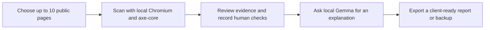

# AccessSprint

### Local-first accessibility reviews for independent developers.

Turn a bounded website scan into a clear, human-checked action plan you can deliver to a client. AccessSprint runs locally, stores audit records on your computer, and uses your own Gemma model to explain scanner evidence in plain language.

> **The service idea:** offer a focused accessibility review, share prioritized findings and practical next steps, then rescan after fixes. No hosted AI bill per report, and your client evidence stays on your device.

---

## How it works



AccessSprint is built for freelance developers who want to add small, fixed-scope accessibility reviews to their services. It keeps automated results and your hands-on observations distinct, so a model suggestion never becomes a confirmed finding on its own.

## What you can do

| Collect evidence | Make sense of it | Deliver the work |
| --- | --- | --- |
| Scan up to 10 URLs you choose with local Chromium and axe-core | Filter findings, inspect element evidence, add notes, and track review status | Prepare a printable client report and save it as PDF |
| See per-page scan status, including pages that fail | Ask local Gemma for impact, repair, and verification guidance | Export or restore a versioned JSON backup |
| Compare saved scans to spot new and resolved evidence | Record six hands-on checks separately from automation | Keep a timeline of audit activity |

### Designed for useful, careful reviews

- **Human judgment stays in charge.** Gemma explains evidence; it cannot create findings or change review states.
- **A small, explicit scope.** Scan only the public pages you list. AccessSprint does not crawl a site.
- **Local by default.** Audit data stays in SQLite on your computer, and model requests go to Ollama on loopback.
- **Clear report limits.** Reports describe the scanned scope and explain that results are not a certification or guarantee.

## Get started on Windows

### Requirements

- Windows 10 or 11
- Python 3.11 or newer
- Node.js 20 or newer
- Ollama and `gemma4:e4b` for local model explanations (optional for scanning and reports)

### 1. Install the project dependencies

Open PowerShell in the project folder and run:

```powershell
npm ci
npx playwright install chromium
```

### 2. Set up Gemma (optional)

Start Ollama, then pull the model:

```powershell
ollama pull gemma4:e4b
```

### 3. Start AccessSprint

Double-click **Start AccessSprint.bat**. It opens the app at `http://127.0.0.1:8000` and keeps a local server window open while you work. **Use that local address, not `web/index.html` opened as a file.** The server provides the app’s styles and backend; direct `file://` access is not supported.

If port 8000 is already in use, start it manually on another port:

```powershell
python main.py --port 8001
```

Then open `http://127.0.0.1:8001`.

<details>
<summary><strong>Troubleshooting</strong></summary>

- **Python is missing:** install Python and enable the `py` launcher, or run `python main.py` from PowerShell.
- **Chromium is missing:** run `npx playwright install chromium`.
- **Ollama is offline:** scans and reports still work. Start Ollama, then choose **Test local model** under **Model setup**.
- **The Gemma tag is missing:** run `ollama pull gemma4:e4b`, then retry.
- **The page looks unstyled:** check that you opened the `127.0.0.1` address and that the server window is still running.

</details>

## Privacy and safe scanning

- The app binds to `127.0.0.1` and stores its SQLite database under `%LOCALAPPDATA%\AccessSprint`.
- AccessSprint has no hosted service or analytics; the app runs on your computer.
- Scanner navigation, redirects, subrequests, and WebSockets are checked against public-address rules. Local and private destinations are blocked.
- Only the URLs you explicitly list are scanned. Do not enter credentials or scan authenticated pages; get permission before scanning a site.
- Gemma explanations send the selected rule, impact, concise rule description, and bounded sanitized evidence to local Ollama. The prompt omits the client name, project notes, and page HTML. Inspect the context before relying on model output.
- JSON backup import creates a new audit and leaves existing audits unchanged. Keep backups somewhere safe and import only files you trust.

## What the report does—and does not—say

axe-core catches only a portion of accessibility issues. Keyboard, screen-reader, zoom, form, and workflow checks need a person. Results apply to the listed pages at the time of the scan. Review each finding and use the hands-on checklist; AccessSprint does not certify WCAG conformance or provide legal advice.

The service-first workflow is a starting point for a side business, not proof of market demand. Talk with prospective clients and validate your scope and pricing before building a subscription around it.

## Development

Run the automated checks from the project folder:

```powershell
python -m unittest discover -v
npm test
```

The suite covers URL safety, SQLite and API behavior, Ollama responses, Chromium/axe fixtures, and a complete browser workflow with a deterministic scanner.

## License

AccessSprint is available under the [MIT License](LICENSE). axe-core is included under its own terms in [LICENSE-AXECORE.txt](LICENSE-AXECORE.txt); dependencies retain their respective licenses.
